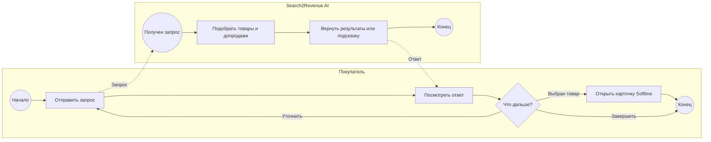
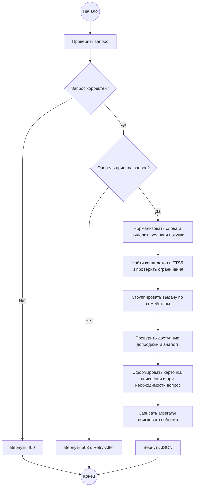
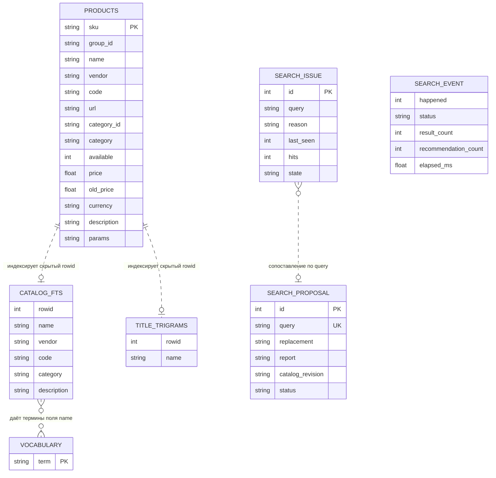

# Search2Revenue AI

Прототип для задачи «Умный поиск на сайте» хакатона «ИИкузница». В каталоге Softline можно искать в свободной форме по названию, артикулу или условиям покупки. В карточке видны подтверждённые условия лицензии. У сопутствующих товаров указаны причина рекомендации и источник.

## Демонстрация

1. На стенде введите `Касперского расширенного продлить на 300 компов`. Замените 300 на 200 и сравните диапазоны устройств в карточках.
2. Введите `Астра линукс и защита рабочих мест`. Откройте источник рядом с рекомендацией и проверьте, чем подтверждена совместимость.
3. Введите `max patrol`. Сравните прямое совпадение с тремя сопутствующими семействами, для которых магазин указывает цену по запросу.

[Открыть стенд](https://search2revenue.193-8-112-239.sslip.io/)

## Запуск

Нужен Python 3.12 с SQLite FTS5. Скачайте `Mindbox.yml.gz.xml` из [папки задания](https://drive.google.com/drive/folders/1KPh2iP3na1fdNlsYYErohSRvR7GD_Eua) и положите файл в `materials`. Импортёр по сигнатуре определяет, сжата ли выгрузка. Зависимость из `requirements.txt` нужна для безопасного чтения XML.

```powershell
py -3.12 -m pip install -r requirements.txt
py -3.12 ingest.py --feed materials/Mindbox.yml.gz.xml
py -3.12 app.py --port 8178
```

Откройте [локальный стенд](http://127.0.0.1:8178). В Linux и macOS замените `py -3.12` на `python3.12`.

Локальные исходные данные, индекс и журнал исключены из Git. SHA-256 проверенной выгрузки `27eaec9e77942c61d58b3c04dcaa8991c707dc0fc64a6442a7408d9908cb148`.

## Что проверить

- `сервак` выводит серверное оборудование. Похожие названия лицензионного ПО исключаются.
- `Касперского расширенного продлить на 300 компов` проверяет диапазон устройств. Изменение 300 на 200 переключает варианты на соседний диапазон.
- `1С Автотранспорт Проф на 20 мест без USB` проверяет редакцию, число мест и формат поставки. В выдаче остаётся одна карточка на семейство.
- `Астра линукс и защита рабочих мест` показывает лицензии Astra Linux и совместимый продукт для криптографической защиты со ссылкой на документацию производителя.
- `сервер и резервное копирование` можно повторить с демо-профилем Windows Server 2019. Профиль задаёт параметры среды для проверки допродажи.
- `max patrol` показывает продление EPP и три семейства с ценой по запросу из официальной витрины Softline. Под каждой рекомендацией есть основание и ссылка. По запросу `MaxPatrol EPP новая лицензия на 150 ПК для Windows` можно проверить аналог с подтверждённым диапазоном.
- `Microsoft Office для дома и бизнеса, антивирус уже есть` оставляет резервное копирование и удалённый доступ среди рекомендаций. Сервис учитывает условие из текущего запроса.
- В аналитике видно, по скольким запросам нашлись четыре семейства, сколько запросов осталось без результатов и сколько получило рекомендации. Там же указано среднее время обработки на сервере. Журнал локальной панели менеджера хранит только неудачные запросы. При записи сервис скрывает распознанные адреса почты, номера телефонов и ссылки. В Compose панель менеджера и подробный журнал отключены.
- На широком экране кнопка «Результаты списком» переносит сопутствующие товары под основную выдачу.

## Устройство

Импортёр читает выгрузку потоком и строит локальный индекс SQLite. Перед поиском сервис нормализует жаргон и названия, а опечатки сопоставляет со словарём каталога по триграммам. BM25 учитывает название, производителя, артикул, категорию и описание с разными весами. При ранжировании сервис отдельно учитывает совпадения в названии и проверяет условия лицензии по полям карточки товара.

Каждое семейство (`group_id`) может занять одно место в топ-4. В первую очередь сервис показывает подходящие товары в наличии с ценой выше нуля. Если таких вариантов нет, он рассматривает остальные подходящие товары. Часть мест могут занять сопутствующие товары из других семейств. В их карточках есть причина рекомендации и ссылка на источник.

Прототип использует Python, SQLite и JavaScript. Для поиска достаточно локального индекса и справочника проверенных карточек Softline. Внешние API и LLM не нужны. Цены и наличие взяты из снимка каталога. Карточки из справочника имеют `quote_only: true`: цена и условия лицензирования уточняются в магазине.

## Запросы к API

| Запрос | Что возвращает |
|---|---|
| `GET /api/search?q=AnyDesk&context=windows-office` | Прямые совпадения (`items`), допродажи (`recommendations`), аналоги (`alternatives`), число прямых совпадений и допродаж (`top_four_count`). При наличии возвращает связанные запросы и пояснения. |
| `GET /api/suggestions?q=astra` | Подсказки для ввода и предварительную допродажу (`companion_preview`). В агрегатах поиска подсказки не учитываются. |
| `GET /api/analytics` | Число поисков, распределение по статусам, количество полных выдач и среднее время обработки. |
| `GET /health` или `HEAD /health` | Проверку доступности процесса. |

Поиск и подсказки принимают `q` от 1 до 240 символов после обрезки пробелов. Необязательный параметр `context` задаёт демо-профиль `windows-office` (Windows 11) или `windows-server` (Windows Server 2019). При пустой выдаче поиск возвращает HTTP 200 со статусом `no_results`. При заполненной очереди — HTTP 503 с заголовком `Retry-After`.

[Спецификация OpenAPI 3.1](docs/openapi.yaml) включает параметры, форматы ответов, ошибки и маршрут одобрения предложений для локальной панели менеджера.

## Проверки

```powershell
py -3.12 -m unittest discover -s tests -v
node --test tests/frontend.test.cjs
py -3.12 benchmark.py --workbook materials/search-queries.xlsx
py -3.12 eval_companions.py
```

Для `benchmark.py` сохраните файл `Выборка поисковых запросов.xlsx` из папки задания под именем `materials/search-queries.xlsx`. Скрипт сопоставляет ссылки на семейства с позициями каталога по производителю, названию и категории. Исходные запросы Softline и авторские перефразировки оцениваются раздельно.

| Выборка | Поиск по ключевым словам | Search2Revenue AI |
|---|---:|---:|
| Запросы Softline, нужное семейство на первом месте | 6 из 10 | 10 из 10 |
| Запросы Softline, нужное семейство среди первых четырёх | 7 из 10 | 10 из 10 |
| Авторские перефразировки, нужное семейство на первом месте | 29 из 50 | 50 из 50 |
| Авторские перефразировки, нужное семейство среди первых четырёх | 34 из 50 | 50 из 50 |

Отдельная проверка полноты считает разные семейства в прямой выдаче и допродажах. На исходных запросах получилось 40 из 40 позиций, включая три карточки MaxPatrol из открытой витрины Softline. При ограничении источника исходным XML остаётся 37 из 40. Скрипт `eval_companions.py` проверяет ожидаемые и недопустимые карточки. Прошли 36 из 36 контрольных сценариев. Для оценки влияния на продажи нужны данные пилота.

Для нагрузочной проверки изолированного процесса используйте `py -3.12 load_check.py`. Чтобы проверить запущенный Docker, укажите `--port 8183`. Сервис одновременно вычисляет четыре поиска и допускает до 28 ожидающих запросов. При переполнении очереди или ожидании дольше шести секунд сервис отвечает `503` с `Retry-After`. Проверка `/health` обслуживается независимо от поисковой очереди.

## Схемы

### BPMN — подбор товара покупателем

Редактируемая модель процесса в формате [BPMN 2.0](docs/search-process.bpmn). Пунктиром показан обмен между покупателем и сервисом.



### UML Activity — обработка поискового запроса

[Исходник диаграммы PlantUML](docs/search-activity.puml).



Схема относится к `/api/search`. Подсказки обрабатываются отдельным маршрутом без записи поискового события.

### ERD — данные каталога и аналитики



`PRODUCTS`, виртуальные индексы `catalog` и `title_trigrams`, а также `vocabulary` находятся в `catalog.sqlite`. Журнал, проблемы и предложения хранятся в отдельной базе `events.sqlite`. Пунктир показывает зависимости по индексу или связи в логике приложения. В схеме SQLite внешних ключей между этими таблицами нет. Для `search_issue` уникальна пара `query, reason`.

## Контейнер

`docker compose up -d --build` запускает стенд на `127.0.0.1:8183`. Переменная `SEARCH_BIND_PORT` меняет локальный порт, если 8183 занят. Compose копирует индекс в tmpfs и включает кеш повторных запросов. Перед открытием порта приложение проверяет, что в индексе есть товары и доступны таблицы поиска. При ошибке оно завершает запуск и пишет причину в журнал контейнера. При замене снимка используйте `docker compose restart search`, чтобы загрузить новый индекс и очистить кеш. В tmpfs должно хватать места для файла индекса. События остаются в отдельном постоянном томе.

```powershell
docker build -t search2revenue .
docker run --rm -p 127.0.0.1:8178:8000 --mount "type=bind,source=$PWD/data,target=/catalog,readonly" --mount "type=volume,source=search2revenue-events,target=/events" search2revenue
```

Для размещения у провайдера загрузите готовый индекс или соберите его из выгрузки на сервере. Подключите постоянный диск для журнала статистики и настройте HTTPS через прокси провайдера.

## Стоимость стенда

Аренда демонстрационного сервера стоит 239 ₽ в месяц. При ориентире из задания в 500 поисков в день за 30 дней получится 15 000 поисков, или около 1,59 копейки за поиск. Это расчёт по полной сумме оплаты VPS. На внешние модели и платные API уходит 0 ₽. В расчёт входят поиск, подбор лицензий и допродажи на одном сервере. Подключение к магазину, сопровождение и резервное копирование считаются отдельно.

[Калькулятор Excel](docs/economics.xlsx) · [Скачать со стенда](https://search2revenue.193-8-112-239.sslip.io/materials/docs/economics.xlsx)
