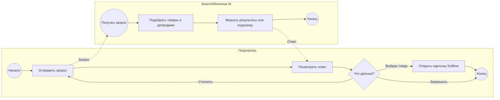
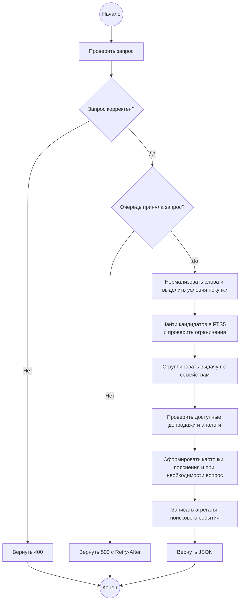
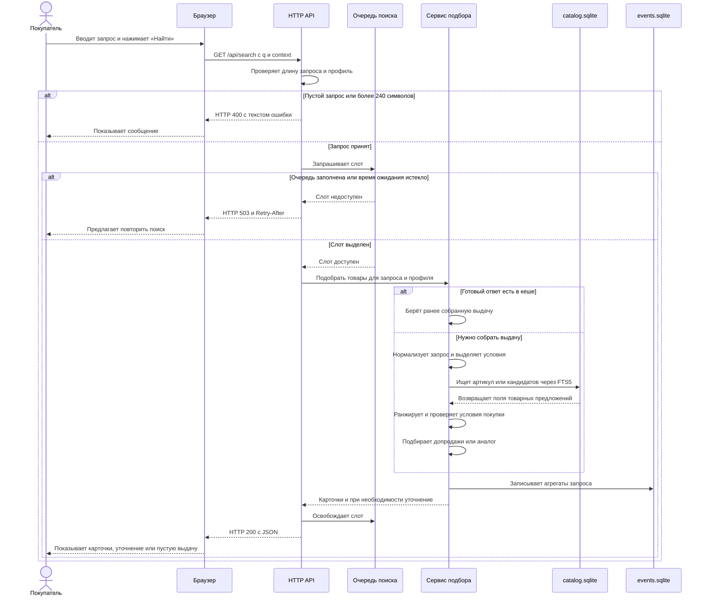
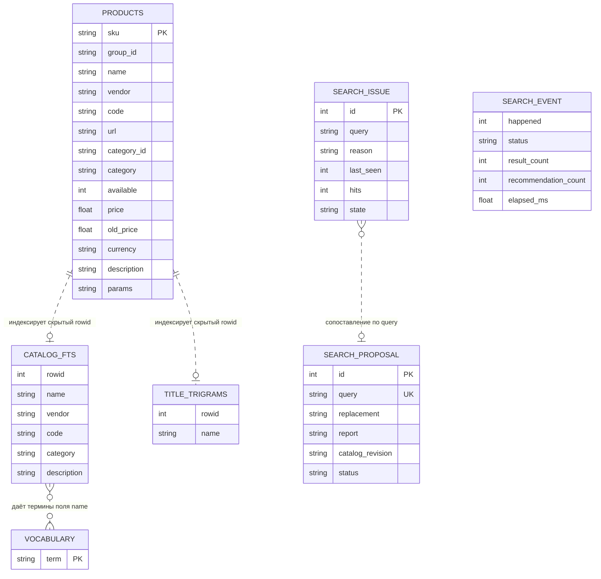

# Search2Revenue AI

Я разработала Search2Revenue AI для задачи поиска по каталогу Softline на хакатоне «ИИкузница». В сервисе можно искать по названию, артикулу или условиям покупки. В карточке товара видны подтверждённые условия лицензии, у допродажи — причина рекомендации и источник.

## Демонстрация

1. На стенде введите `Касперского расширенного продлить на 300 компов`. Замените 300 на 200 и сравните диапазоны устройств в карточках.
2. Введите `Астра линукс и защита рабочих мест`. Откройте источник рядом с рекомендацией и проверьте, чем подтверждена совместимость.
3. Введите `max patrol`. Сравните прямое совпадение с тремя сопутствующими семействами, для которых магазин указывает цену по запросу.

[Открыть стенд](https://search2revenue.193-8-112-239.sslip.io/)

Видео-презентация демонстрации: https://disk.yandex.ru/i/jWUa_bA90eeA6w

## Запуск

Нужен Python 3.12 с SQLite FTS5. Скачайте `Mindbox.yml.gz.xml` из [папки задания](https://drive.google.com/drive/folders/1KPh2iP3na1fdNlsYYErohSRvR7GD_Eua) и положите файл в `materials`. Импортёр по сигнатуре определяет, сжата ли выгрузка. Зависимость из `requirements.txt` нужна для безопасного чтения XML.

```powershell
py -3.12 -m pip install -r requirements.txt
py -3.12 ingest.py --feed materials/Mindbox.yml.gz.xml
py -3.12 app.py --port 8178
```

Откройте [локальный стенд](http://127.0.0.1:8178). В Linux и macOS замените `py -3.12` на `python3.12`.

Локальные исходные данные, индекс и журнал исключены из Git. SHA-256 проверенной выгрузки `27eaec9e77942c61d58b3c04dcaa8991c707dc0fc64a6442a7408d9908cb148`.

## Что проверить

- `сервак` выводит серверное оборудование. В ответе появляется пояснение `сервак → сервер` (поле `corrections`). Похожие названия лицензионного ПО исключаются.
- `Касперского расширенного продлить на 500 компов` просит уточнить артикул, если в каталоге нет подтверждённого продления на это количество.
- `1С Автотранспорт Проф на 20 мест без USB` проверяет редакцию, число мест и формат поставки. В выдаче остаётся одна карточка на семейство.
- `Астра линукс и защита рабочих мест` показывает лицензии Astra Linux и совместимый продукт для криптографической защиты со ссылкой на документацию производителя.
- `сервер и резервное копирование` можно повторить с демо-профилем Windows Server 2019. Профиль задаёт параметры среды для проверки допродажи.
- `max patrol` показывает продление EPP и три семейства с ценой по запросу из официальной витрины Softline. Под каждой рекомендацией есть основание и ссылка. По запросу `MaxPatrol EPP новая лицензия на 150 ПК для Windows` можно проверить аналог с подтверждённым диапазоном.
- `Microsoft Office для дома и бизнеса, антивирус уже есть` оставляет резервное копирование и удалённый доступ среди рекомендаций. Сервис учитывает условие из текущего запроса.
- В аналитике видно, по скольким запросам нашлись четыре семейства, сколько запросов осталось без результатов и сколько получило рекомендации. Там же указано среднее время обработки на сервере. Журнал локальной панели менеджера хранит только неудачные запросы. При записи сервис скрывает распознанные адреса почты, номера телефонов и ссылки. В Compose панель менеджера и подробный журнал отключены.
- На широком экране кнопка «Результаты списком» переносит сопутствующие товары под основную выдачу.

## Устройство

Импортёр читает выгрузку потоком и строит локальный индекс SQLite. Перед поиском сервис нормализует жаргон и названия. Опечатки сопоставляет со словарём каталога по триграммам, но само исправление применяется только после одобрения менеджером в очереди предложений: до одобрения запрос `asrta` возвращает «нет результатов», а предложение `astra` видно только в очереди. BM25 учитывает название, производителя, артикул, категорию и описание с разными весами. При ранжировании сервис отдельно учитывает совпадения в названии и проверяет условия лицензии по полям карточки товара.

Каждое семейство (`group_id`) может занять одно место в топ-4. В первую очередь сервис показывает подходящие товары в наличии с ценой выше нуля. Если таких вариантов нет, он рассматривает остальные подходящие товары. Часть мест могут занять сопутствующие товары из других семейств. В их карточках есть причина рекомендации и ссылка на источник.

Поиск работает на Python, SQLite и JavaScript, без внешних API и LLM. Цены и наличие берутся из снимка каталога. Для карточек из открытой витрины с признаком `quote_only: true` магазин уточняет цену и условия поставки.

## Запросы к API

| Запрос | Что возвращает |
|---|---|
| `GET /api/search?q=AnyDesk&context=windows-office` | Прямые совпадения (`items`), допродажи (`recommendations`), аналоги (`alternatives`), число прямых совпадений и допродаж (`top_four_count`). При наличии возвращает связанные запросы и пояснения. |
| `GET /api/suggestions?q=astra` | Подсказки для ввода и предварительную допродажу (`companion_preview`). В агрегатах поиска подсказки не учитываются. |
| `GET /api/analytics` | Число поисков, распределение по статусам, количество полных выдач и среднее время обработки. |
| `GET /health` или `HEAD /health` | Проверку доступности процесса. |

Поиск и подсказки принимают `q` от 1 до 240 символов после обрезки пробелов. Необязательный параметр `context` задаёт демо-профиль `windows-office` (Windows 11) или `windows-server` (Windows Server 2019). При пустой выдаче поиск возвращает HTTP 200 со статусом `no_results`. При заполненной очереди — HTTP 503 с заголовком `Retry-After`.

[Спецификация OpenAPI 3.1](docs/openapi.yaml) включает параметры, форматы ответов, ошибки и маршрут одобрения предложений для локальной панели менеджера.

## Проверки

```powershell
py -3.12 -m unittest discover -s tests -v
node --test tests/frontend.test.cjs
py -3.12 benchmark.py --workbook materials/search-queries.xlsx
py -3.12 eval_companions.py
```

Для `benchmark.py` сохраните файл `Выборка поисковых запросов.xlsx` из папки задания под именем `materials/search-queries.xlsx`. Скрипт сопоставляет карточки с эталоном по производителю, названию и категории.

## Сравнение вариантов

| Проверка | Базовый BM25 | BM25 с нормализацией и проверкой условий |
|---|---:|---:|
| Запросы Softline, нужное семейство на первом месте | 6 из 10 | 10 из 10 |
| Запросы Softline, нужное семейство среди первых четырёх | 7 из 10 | 10 из 10 |
| Авторские перефразировки, нужное семейство на первом месте | 29 из 50 | 50 из 50 |
| Авторские перефразировки, нужное семейство среди первых четырёх | 34 из 50 | 50 из 50 |
| Медианное время на запросах Softline в том же локальном прогоне | 19,1 мс | 84,7 мс |

Я выбрала для стенда **SQLite FTS5/BM25 с нормализацией запроса и проверкой товарных условий**. За точку сравнения взяла базовый BM25. Авторские перефразировки использовала при разработке.

**Допродажи я проверила отдельно.** По одному XML получилось заполнить 37 из 40 позиций. Три карточки MaxPatrol из открытой витрины Softline с ценой по запросу довели результат до 40 из 40. В отдельном прогоне прошли 36 из 36 сценариев проверки карточек.

### Девять способов на одной выборке

Я сравнила все варианты локально на одних и тех же 914 семействах. Время измерила на прогретом CPU по 22 запросам. Качество поиска по назначению оценила на 11 запросах с размеченными кандидатами. В колонках «топ-4» указано, в скольких запросах среди первых четырёх карточек нашлось нужное семейство.

| Способ | Топ‑4 Softline | Топ‑4 по назначению | MRR@4 | Медиана / p95, мс | Пик RAM этапа, МиБ |
|---|---:|---:|---:|---:|---:|
| S1. Векторный E5-small | 10/10 | 5/11 | 0,587 | 8,7 / 14,4 | 510,3 |
| S2. BM25 | 8/10 | 0/11 | 0,381 | 0,3 / 0,9 | 64,7 |
| S3. BM25 + E5 с весами | 10/10 | 3/11 | 0,472 | 9,2 / 14,8 | 510,3 |
| S4. BM25 + E5 через RRF | 10/10 | 0/11 | 0,429 | 9,2 / 14,7 | 510,3 |
| S5. E5-small + реранкер | 10/10 | 4/11 | 0,560 | 977,5 / 1 164,0 | 517,3 |
| S6. S3 + реранкер | 10/10 | 3/11 | 0,571 | 1 010,6 / 1 252,5 | 517,3 |
| S7. E5-base + реранкер | 10/10 | 4/11 | 0,587 | 960,3 / 1 244,2 | 724,0 |
| S8. Две переформулировки Qwen + E5-small | 3/10 | 2/11 | 0,214 | 6 823,9 / 7 544,3 | 1 364,4 |
| S9. S8 + реранкер | 6/10 | 3/11 | 0,357 | 7 778,5 / 8 334,7 | 1 364,4 |
| Алгоритм стенда: FTS5/BM25 + товарные правила | 9/10 | 0/11 | 0,429 | 14,3 / 21,8 | 74,0 |

Я проверила девять конфигураций одного процесса поиска. В них меняются четыре этапа.

- **Получение кандидатов, S1 и S2.** E5-small ищет по смыслу, BM25 — по совпадениям слов в полях товара. E5 дал лучший результат на запросах по назначению, 5 из 11. Удалённую поддержку пропустили оба.
- **Объединение списков, S3 и S4.** Источники одинаковые. S3 складывает нормализованные оценки, RRF в S4 использует места в списках. Получилось 3 из 11 попаданий по назначению у S3 и 0 из 11 у S4.
- **Повторное ранжирование, S5–S7.** MiniLM переставляет 12 найденных кандидатов. Меняется набор на входе: E5-small, гибрид S3 или E5-base. S6 дал 10 из 10 первых мест на запросах Softline при медиане 1,01 с.
- **Переформулировка, S8 и S9.** Qwen добавляет две формулировки к исходному запросу. S9 дополнительно запускает MiniLM. На запросах Softline попадание в топ‑4 составило 3 из 10 у S8 и 6 из 10 у S9 при медиане 6,8–7,8 с.

**Что я оставила на стенде.** Как и в S2, кандидатов ищу через SQLite FTS5 и BM25. Перед поиском сервис нормализует названия и жаргон, исправляет опечатки по словарю каталога и отдельно ищет точный артикул. После поиска правила проверяют редакцию, тип лицензии, количество устройств, ОС и способ поставки. Затем сервис убирает дубли семейств и добавляет подтверждённые допродажи.

На полном каталоге этот вариант дал **10 из 10 первых мест** вместо **6 из 10** у базового BM25. Я также проверила семь сценариев с артикулами и условиями покупки. Например, для продления Kaspersky на 300 ПК сервис находит подтверждённую лицензию, а для 500 ПК просит уточнить артикул. На сокращённой выборке S6 дал 10 из 10 первых мест при медиане около секунды, а S1 лучше всего находил товары по назначению. Эти результаты показывают, где модели могут помочь поиску. Для стенда я оставила проверку условий по каталогу и поиск без моделей. [Методика и разбор ошибок](docs/search-comparison.md)

## Нагрузка

Для нагрузочной проверки изолированного процесса используйте `py -3.12 load_check.py`. Для запущенного Docker добавьте `--port 8183`.

В одном процессе до 4 запросов поиска и подсказок обрабатываются одновременно, ещё до 28 могут ждать. Когда слот освобождается, его занимает следующий запрос. При переполнении очереди или ожидании слота дольше шести секунд сервис возвращает `503` с заголовком `Retry-After`. Проверка `/health` обслуживается отдельно.

Я проверила стенд в рамках характеристик арендованного VPS — **1 vCPU, 1 ГБ RAM, 10 ГБ NVMe**. В этом прогоне при восьми параллельных клиентах успешно обработаны все 36 запросов поиска и подсказок. p95 составил **585 мс**. Предел пропускной способности стенда на этом VPS я не измеряла.

При росте трафика поисковые инстансы можно поставить за балансировщиком. Каждый читает локальную копию одного снимка каталога. Общий кеш сокращает повторные вычисления, а аналитика и правила менеджера получают общее хранилище. Лимиты входящего трафика и короткие очереди на каждом инстансе позволяют пережить всплеск. Число инстансов рассчитывают по замеренным запросам в секунду при заданных p95 и доле ошибок.

## Схемы

### BPMN — подбор товара покупателем

Редактируемая модель процесса в формате [BPMN 2.0](docs/search-process.bpmn). Пунктиром показан обмен между покупателем и сервисом.



### UML Activity — обработка поискового запроса

[Исходник диаграммы PlantUML](docs/search-activity.puml).



Схема относится к `/api/search`. Подсказки обрабатываются отдельным маршрутом без записи поискового события.

### UML Sequence — от запроса до карточек



Кеш выдачи включён на стенде. Задержка или ошибка записи в журнал не отменяет результат поиска.

### ERD — данные каталога и аналитики



`PRODUCTS`, виртуальные индексы `catalog` и `title_trigrams`, а также `vocabulary` находятся в `catalog.sqlite`. Журнал, проблемы и предложения хранятся в отдельной базе `events.sqlite`. Пунктир показывает зависимости по индексу или связи в логике приложения. В схеме SQLite внешних ключей между этими таблицами нет. Для `search_issue` уникальна пара `query, reason`.

## Контейнер

`docker compose up -d --build` запускает стенд на `127.0.0.1:8183`. Переменная `SEARCH_BIND_PORT` меняет локальный порт, если 8183 занят. Compose копирует индекс в tmpfs и включает кеш повторных запросов. Перед открытием порта приложение проверяет, что в индексе есть товары и доступны таблицы поиска. При ошибке оно завершает запуск и пишет причину в журнал контейнера. При замене снимка используйте `docker compose restart search`, чтобы загрузить новый индекс и очистить кеш. В tmpfs должно хватать места для файла индекса. События остаются в отдельном постоянном томе.

```powershell
docker build -t search2revenue .
docker run --rm -p 127.0.0.1:8178:8000 --mount "type=bind,source=$PWD/data,target=/catalog,readonly" --mount "type=volume,source=search2revenue-events,target=/events" search2revenue
```

Для размещения у провайдера загрузите готовый индекс или соберите его из выгрузки на сервере. Подключите постоянный диск для журнала статистики и настройте HTTPS через прокси провайдера.

## Стоимость стенда

Аренда демонстрационного сервера стоит 239 ₽ в месяц. При ориентире из задания в 500 поисков в день за 30 дней получится 15 000 поисков, или около 1,59 копейки за поиск. Это расчёт по полной сумме оплаты VPS. На внешние модели и платные API уходит 0 ₽. В расчёт входят поиск, подбор лицензий и допродажи на одном сервере. Подключение к магазину, сопровождение и резервное копирование считаются отдельно.

Презентация с экономикой: https://disk.yandex.ru/i/_U8wpFastYKl2g

[Калькулятор Excel](docs/economics.xlsx) · [Скачать со стенда](https://search2revenue.193-8-112-239.sslip.io/materials/docs/economics.xlsx)
